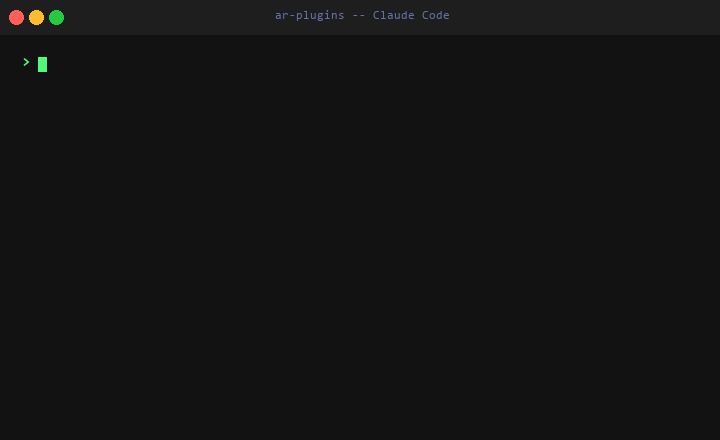

# AR Plugins

Plugins para **Claude Code** y **OpenAI Codex** que saben cosas de Argentina: el dólar y la inflación de hoy, cuánto se cobra por tu laburo y cómo facturar al monotributo. Datos de fuentes oficiales, con fuente y fecha en cada respuesta.

<p align="center">
  
</p>

<p align="center">
  
</p>

## Instalar

Dentro de Claude Code (v2.1.275 o posterior), un solo comando agrega el marketplace e instala el plugin:

```
/plugin install arca --marketplace kvothesson/ar-plugins
```

En versiones anteriores, en dos pasos:

```
/plugin marketplace add kvothesson/ar-plugins
/plugin install arca@ar-plugins
```

Cambiá `arca` por cualquier plugin de abajo.

**Recibir los arreglos automáticamente.** Los marketplaces que no son de Anthropic vienen con la actualización automática apagada. Para prenderla: `/plugin` → pestaña **Marketplaces** → `ar-plugins` → **Enable auto-update**.

---

## Los tres para empezar

### arca: el dólar y la inflación de hoy

```
/arca

💵 Dólar — 24 oct 2026

Oficial     $1.500  / $1.550
Blue        $1.545  / $1.565
MEP         $1.557  / $1.564
CCL         $1.649  / $1.654
Tarjeta     $1.950  / $2.015

Brecha blue vs oficial: +1,0%

Fuente: dolarapi.com — 24 oct 2026
```

```
/arca inflacion

📈 Inflación — IPC Nacional

Último mes (ago 2026):    1,66%
Últimos 12 meses:        33,54%

Fuente: INDEC — apis.datos.gob.ar
```

### laburo: cuánto se cobra

Rangos de sueldo por puesto, paritarias, salario mínimo, tarifas freelance y CV.

```
/laburo sueldo desarrollador

## Sueldos — Desarrollador de Software (Argentina)

Junior (0–2 años):   $1.200.000 – $1.800.000 bruto/mes
Semi Senior (2–4):   $1.800.000 – $2.800.000 bruto/mes
Senior (4+):         $2.800.000 – $4.500.000+ bruto/mes

Fuente: encuesta SysArg, encuesta Openqube — mayo 2026
```

### facturar: facturas del monotributo desde la terminal

Facturas C y E y notas de crédito contra ARCA (ex AFIP) con PyARCA. Se configura solo la primera vez, **arranca en homologación** (el ambiente de prueba de ARCA) y nunca emite en producción sin que confirmes.

```
/facturar:facturar factura

Voy a emitir:
  Factura C — $1.500.000 — Empresa XYZ SRL
  Periodo: 2026-04-01 → 2026-04-30
  Ambiente: PRODUCCION ⚠️

¿Confirmas?
```

---

## Para tu equipo

Un plugin se puede activar para todo un repositorio. Queda anotado en `.claude/settings.json`, que se commitea, y cada persona del equipo lo instala una vez:

```bash
claude plugin install facturar@ar-plugins --scope project
```

Sirve, por ejemplo, para tener `facturar` en el repo de administración de una consultora o `arca` en el de finanzas.

---

## Todos los plugins

| Plugin | Qué hace |
|--------|----------|
| [arca](https://github.com/kvothesson/arca) | Dólar, inflación, canasta y tu sueldo en dólares |
| [laburo](https://github.com/kvothesson/laburo) | Sueldos, paritarias, salario mínimo, tarifas freelance, CV |
| [facturar](https://github.com/kvothesson/facturar) | Facturación electrónica del monotributo: facturas C y E, notas de crédito |
| [guita](https://github.com/kvothesson/guita) | Ingreso neto real, gastos ajustados por inflación y runway |
| [tramite](https://github.com/kvothesson/tramite) | ANSES, ARCA (ex AFIP), DNI, registro automotor |
| [derecho](https://github.com/kvothesson/derecho) | Derecho laboral, del consumidor, contratos y sociedades en lenguaje llano |
| [salud](https://github.com/kvothesson/salud) | Obras sociales, PAMI, hospitales públicos y precios de medicamentos |
| [dato](https://github.com/kvothesson/dato) | INDEC, elecciones, catastro, jurisprudencia |
| [startup](https://github.com/kvothesson/startup) | Fondos públicos y privados, constitución de SAS, equity y pitch |
| [medios](https://github.com/kvothesson/medios) | Agenda del día, cobertura comparada por medio, verificación de afirmaciones |
| [educacion](https://github.com/kvothesson/educacion) | Becas, dónde estudiar cada carrera, certificaciones e inglés gratis |

**Herramientas y extras:**

| Plugin | Qué hace |
|--------|----------|
| [reportar](https://github.com/kvothesson/reportar) | Cuando el agente detecta un problema en un plugin, te ofrece abrir el issue con el contexto |
| [nodo](https://github.com/kvothesson/nodo) | Contexto personal que persiste entre sesiones |
| [daemons](https://github.com/kvothesson/daemons-plugin) | Bichos del folklore que observan, diagnostican y ordenan tu entorno |
| [mechas](https://github.com/kvothesson/mechas-plugin) | Análisis de sesiones del Congreso desde YouTube |

---

## Cómo funcionan

Cada plugin es una carpeta con un `SKILL.md` que le dice al agente qué fuentes oficiales consultar cuando usás su comando. No hay caché ni base de datos propia: el dato se busca en el momento en sitios .gob.ar, APIs del INDEC y fuentes primarias, y la respuesta siempre dice de dónde salió y cuándo.

Todos los lunes un chequeo automático prueba cada fuente que usan los plugins y abre un issue si alguna deja de responder.

### Con OpenAI Codex

Cada plugin trae un `AGENTS.md` que Codex lee al abrirse en su carpeta:

```bash
git clone https://github.com/kvothesson/arca ~/plugins/arca
cd ~/plugins/arca
codex
```

### Un plugin suelto, sin marketplace

```bash
git clone https://github.com/kvothesson/arca ~/plugins/arca
claude --plugin-dir ~/plugins/arca
```

---

## ¿Lo usaste?

Si un plugin te sirvió para algo real (facturar, un trámite, negociar un sueldo) o te falló, contalo en un [issue](https://github.com/kvothesson/ar-plugins/issues/new/choose). Eso es lo que decide qué se mejora.

---

## Desarrollo

Ver [AGENT.md](./AGENT.md) y la documentación en [`.agents/`](.agents/). Este repo incluye la skill `/dev`, que lee un issue, implementa el cambio, verifica las fuentes y abre el PR:

```bash
claude --plugin-dir ~/plugins/ar-plugins
```

```
/dev resolver #5
```

Antes de publicar un plugin, `claude plugin validate .` tiene que decir "Validation passed".
